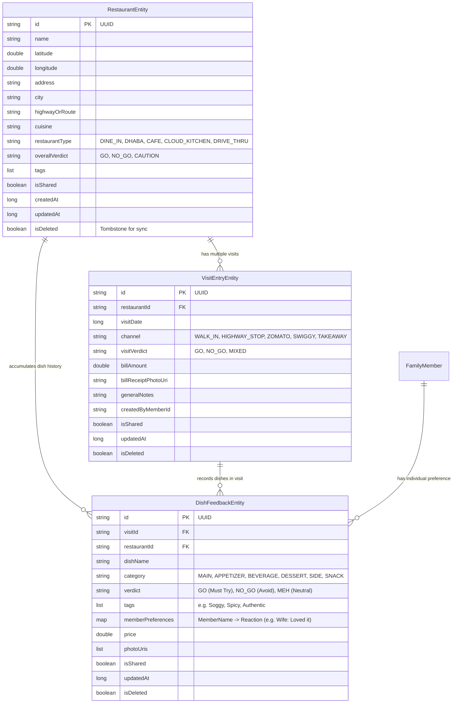
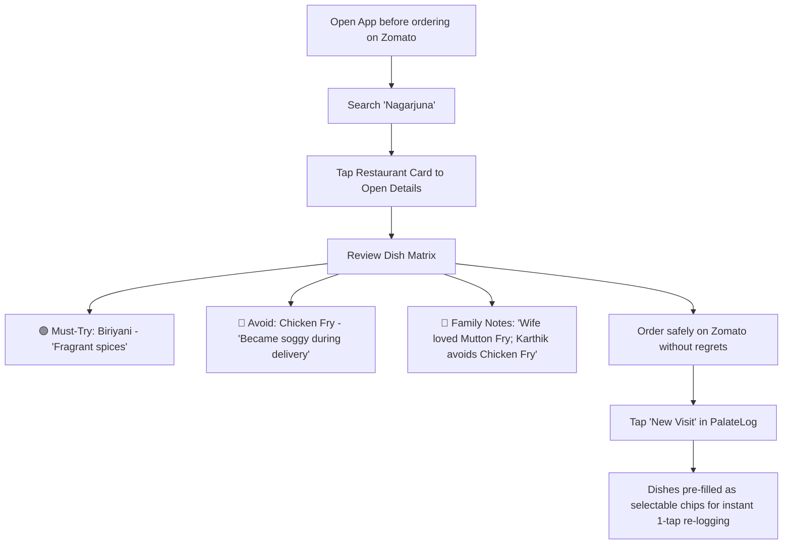

# PalateLog: Architecture & Technical Design Specification

> **Application ID**: `com.prismpixelvertex.palatelog`  
> **Repository**: [https://github.com/karthikeyan-s/palatelog](https://github.com/karthikeyan-s/palatelog)  
> **Platform**: Android (Kotlin 2.0+, Jetpack Compose Material 3)

---

## 1. System Overview

**PalateLog** is an offline-first Android application designed to track, organize, and resurface personal and family dining learnings—from roadside tea stalls and outstation highway dhabas to online food delivery orders (Zomato/Swiggy).

The system addresses three critical memory failure modes:
1. **The Roadside Regret**: Stopping at a tea stall on a highway drive, having terrible tea, and accidentally stopping there again months later because human memory fades.
2. **The Delivery Dish Dichotomy**: Ordering from a restaurant (e.g. *Nagarjuna* on Zomato) where the Biriyani is extraordinary, but the chicken fry arrives soggy and cold. PalateLog isolates dish-level performance so you never order the soggy dish again.
3. **Outstation Family Drives**: Recalling clean restrooms, exceptional highway dhabas, or tourist traps along highway travel corridors (e.g., NH44).

---

## 2. Architectural Blueprint

PalateLog follows Google's recommended **Clean Architecture** with strict Unidirectional Data Flow (UDF) and MVVM:

```
app/src/main/java/com/prismpixelvertex/palatelog/
├── PalateLogApp.kt             # Application class (@HiltAndroidApp, WorkManager config)
├── MainActivity.kt             # Single Activity host with Edge-to-Edge & Compose NavHost
├── core/
│   ├── model/                  # Pure Kotlin domain entities
│   │   ├── Restaurant.kt       # Restaurant entity & Verdict enum (GO, NO_GO, CAUTION)
│   │   ├── VisitEntry.kt       # Visit & order entry (Channel: Walk-in, Zomato, Highway, etc.)
│   │   ├── DishFeedback.kt     # Dish feedback, verdicts (Must Try, Avoid, Meh), family reactions
│   │   └── FamilyMember.kt     # Family member profiles for taste attribution
│   ├── database/               # Room SQLite persistence layer
│   │   ├── PalateLogDatabase.kt# Room DB definition (Version 1)
│   │   ├── *Entity.kt          # Room entities mapping domain models
│   │   ├── *Dao.kt             # DAOs with spatial queries, FTS search, reactive Flows
│   │   └── Converters.kt       # kotlinx.serialization TypeConverters for lists & maps
│   ├── location/               # Location services & Geo mathematics
│   │   ├── LocationClient.kt   # FusedLocationProviderClient + Geocoder wrapper
│   │   └── GeoUtils.kt         # Haversine distance & bounding box calculations
│   ├── navigation/             # External integration
│   │   └── ExternalMapNavigator.kt # Zero-cost turn-by-turn navigation via Google Maps intent
│   ├── sync/                   # Offline-first synchronization & distributed conflict resolution
│   │   ├── SyncModels.kt       # Serializable JSON delta payload schemas
│   │   ├── SyncRepository.kt   # Delta export, LWW conflict-merging, JSON backup
│   │   └── SyncWorker.kt       # WorkManager CoroutineWorker for background sync
│   └── designsystem/           # Material 3 UI design system
│       ├── Color.kt            # Curated gourmet color palette (Amber, Emerald, Crimson)
│       ├── Theme.kt            # Material 3 dark/light theme definitions
│       ├── Type.kt             # Typography scale
│       └── Components.kt       # Badges (VerdictBadge, DishVerdictBadge, ChannelBadge, etc.)
├── feature/                    # UI Feature modules
│   ├── navigation/             # App navigation graph & bottom navigation bar
│   ├── dashboard/              # Home explore screen, search, category filters, restaurant cards
│   ├── quick_capture/          # The 3-second rapid regret logger
│   ├── entry_editor/           # Full visit editor with prefilled remembered dish chips
│   ├── restaurant_detail/      # Dish Matrix (Avoid vs Must Try) & visit history timeline
│   ├── map/                    # Interactive OpenStreetMap with color-coded markers & preview
│   └── settings/               # Family profiles, sync controls, and backup export/restore
└── di/                         # Hilt Dependency Injection modules
    ├── DatabaseModule.kt
    └── LocationModule.kt
```

---

## 3. Data Model & Entity Relations



---

## 4. Primary Workflows

### A. The 3-Second Quick Regret Logger (Speed-First Capture)
```mermaid
graph TD
    A[Tap Floating 'Quick Regret Log' 🔴] --> B[Auto-fetch GPS & Geocoded Address]
    B --> C{Nearby Spot Found within 50m?}
    C -->|Yes| C1[Show One-Tap Reuse Banner]
    C -->|No| C2[Auto-fill Area Name]
    C1 --> D[Select 1-Tap Verdict: NO-GO / GO / CAUTION]
    C2 --> D
    D --> E[Select Quick Reason Chip: 'Watery tea', 'Soggy food', 'Dirty restrooms']
    E --> F[Tap 'Save & Finish (3s)']
    F --> G[Atomic insert to Room DB & return to Explore]
```

### B. The Zomato / Swiggy Delivery Check & Re-ordering


---

## 5. Security, Privacy & Sync Architecture (v1.2.5)

- **Private vs. Shared Isolation**: Each entity carries an `isShared: Boolean` flag. Private entries remain strictly in the local SQLite database. Only shared entries are synchronized to the shared family storage.
- **Offline-First & Sovereign**: The app operates 100% offline. All writes go directly to Room SQLite.
- **Zero-Cost Family Cloud Sync (Dual-Mode)**:
  PalateLog supports flexible, zero-cost cloud sync across family devices without requiring custom server infrastructure. Users can choose between two modes based on their technical preference:

  ### Mode A: Single Shared Family Google Account (Zero-Config)
  - **Setup**: All family members sign into PalateLog using a single designated Gmail address (e.g. `ourfamily.palatelog@gmail.com`).
  - **Behavior**: The app automatically searches for or creates the `PalateLog_Family/` folder in the root directory of that account's Google Drive.
  - **Target Audience**: Non-technical families looking for a 1-tap setup with zero QR codes or invite steps.

  ### Mode B: Individual Google Accounts (Automated In-App Invites & Static QR Code)
  - **Setup**: Each family member signs into PalateLog using their personal Gmail account.
  - **Host Provisioning**: The family host creates the `PalateLog_Family/` folder once. The generated `folderId` is permanent and static.
  - **In-App Automated Invites**: The host enters family member email(s) inside PalateLog. PalateLog automatically grants write access via the Google Drive Permissions REST API (`POST /drive/v3/files/{folderId}/permissions`).
  - **Static QR Code & Deep Link Sharing**: The host shares a static QR code or WhatsApp deep link (`palatelog://sync?folderId=<folderId>`). Family members scan or tap the link to store the target `folderId` in their app.
  - **Graceful Error Recovery & WhatsApp Request**: If an uninvited user scans the QR code before the host adds their email, Google Drive API returns an authorization error (HTTP 404/403). PalateLog catches this error and presents a friendly *Permission Pending* screen with a 1-tap **"Ask Host via WhatsApp"** pre-filled request message.

- **Sync Payload Format**: Data is synchronized as compact canonical JSON delta files (`changes_<deviceId>.json`) updated in-place via Google Drive `PATCH` API.
- **Conflict Resolution**: UUID primary keys prevent collisions. Conflicts across devices are resolved using Last-Write-Wins (LWW) based on `updatedAt` timestamps. Soft-deleted records (`isDeleted = true`) act as tombstones so deletions propagate cleanly across all family phones.
