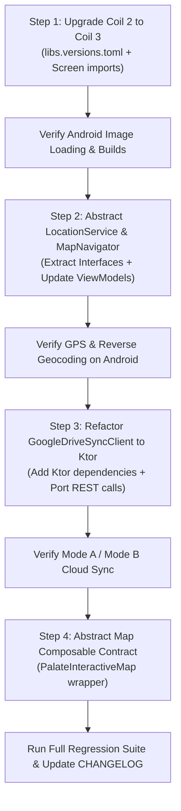

# PalateLog: KMP Readiness Implementation Plan (Low-Hanging Fruit)

> **Branch**: `feature/kmp-ready-foundation`  
> **Status**: Proposed / Pending Review  
> **Target Platform**: Android (100% backward-compatible, Windows-only development environment)  
> **Objective**: Decouple platform-specific dependencies and migrate to multiplatform-first libraries so that a future iOS port requires zero core rewrites.

---

## 1. Executive Summary & Goals

PalateLog is currently an Android-first application built with Kotlin 2.0+, Jetpack Compose Material 3, Room SQLite, Hilt, and Coroutines.

While an immediate iOS release is deferred until user demand and macOS hardware are secured, we want to proactively eliminate architectural debt. By adopting multiplatform-compatible dependencies and clean domain abstractions today:
1. **Zero Android Regression**: The Android app continues to build, run, and pass all existing tests on Windows with zero performance degradation.
2. **KMP-Ready Core**: The domain, network, image loading, and location layers become platform-agnostic, reducing the future iOS migration effort from weeks to days.
3. **No Premature iOS Target Hassle**: We do **not** configure iOS Gradle targets (`iosArm64()`, CocoaPods, or SPM) yet, completely avoiding Xcode and macOS toolchain sync errors on Windows.

---

## 2. Scope & Guiding Principles

### In-Scope (Phase 1: Low-Hanging Fruit)
- **Pillar 1: Image Pipeline (Coil 2 → Coil 3)**
  - Upgrade `io.coil-kt:coil-compose` (v2.7.0) to `io.coil-kt.coil3:coil-compose` (v3.x).
  - Migrate import paths across UI screens.
- **Pillar 2: Network Modernization (OkHttp → Ktor Client)**
  - Replace `OkHttpClient` inside `GoogleDriveSyncClient.kt` with multiplatform `Ktor Client` (`ktor-client-okhttp` / `ktor-client-android`).
  - Maintain exact Google Drive v3 REST API compatibility (Mode A & Mode B sync).
- **Pillar 3: Hardware & System Abstractions (Interface Segregation)**
  - Extract pure Kotlin domain interfaces for `LocationService` (abstracting `FusedLocationProviderClient` and `Geocoder`).
  - Extract `MapNavigator` (abstracting Android `Intent` / `Context` map launch).
  - Extract `PhotoStorageManager` (abstracting Android `FileProvider` and internal file caching).
  - Refactor ViewModels to consume these domain abstractions rather than concrete Android classes.
- **Pillar 4: Map View Contract Isolation**
  - Encapsulate the OpenStreetMap (`osmdroid-android`) implementation behind a clean composable contract (`PalateMapView`) so that an Apple MapKit replacement can be dropped in seamlessly later.

### Explicitly Out-of-Scope (Deferred to Phase 2: iOS Target Activation)
- Adding `iosArm64()`, `iosX64()`, or `iosSimulatorArm64()` Gradle targets.
- Migrating Hilt to Koin (Hilt works reliably today; full DI migration will occur during module decomposition).
- Room KMP Multiplatform SQLite driver configuration.
- Google Sign-In SDK for iOS (CocoaPods/SPM).

---

## 3. Detailed Architecture & Technical Design

### Pillar 1: Image Loading Modernization (Coil 2 → Coil 3)

#### Motivation
Coil 2 (`io.coil-kt`) is strictly an Android library. Coil 3 (`io.coil-kt.coil3`) was redesigned from the ground up for Kotlin Multiplatform (Android, iOS, Desktop, Web) while maintaining Compose-first ergonomics.

#### Changes in `gradle/libs.versions.toml`:
```toml
[versions]
- coil = "2.7.0"
+ coil3 = "3.1.0"

[libraries]
- coil-compose = { group = "io.coil-kt", name = "coil-compose", version.ref = "coil" }
+ coil3-compose = { group = "io.coil-kt.coil3", name = "coil-compose", version.ref = "coil3" }
+ coil3-network-okhttp = { group = "io.coil-kt.coil3", name = "coil-network-okhttp", version.ref = "coil3" }
```

#### Code Migration:
In `EntryEditorScreen.kt` and `RestaurantDetailScreen.kt`:
```kotlin
// Before (Coil 2)
import coil.compose.AsyncImage

// After (Coil 3)
import coil3.compose.AsyncImage
```
The composable signatures (`model`, `contentDescription`, `contentScale`, `modifier`) remain 100% identical.

---

### Pillar 2: Network Client Modernization (OkHttp → Ktor Client)

#### Motivation
Currently, [`GoogleDriveSyncClient.kt`](../app/src/main/java/com/prismpixelvertex/palatelog/core/sync/GoogleDriveSyncClient.kt) uses `okhttp3.OkHttpClient`, `okhttp3.Request`, and `okhttp3.RequestBody`. OkHttp is a JVM/Android library.
By refactoring to `io.ktor.client.HttpClient`, the entire sync client becomes multiplatform-ready. On Android today, Ktor will use the OkHttp engine; on iOS tomorrow, it will use the Darwin engine with zero changes to the Google Drive REST calls.

#### Changes in `gradle/libs.versions.toml`:
```toml
[versions]
ktor = "3.1.1"

[libraries]
ktor-client-core = { group = "io.ktor", name = "ktor-client-core", version.ref = "ktor" }
ktor-client-okhttp = { group = "io.ktor", name = "ktor-client-okhttp", version.ref = "ktor" }
ktor-client-content-negotiation = { group = "io.ktor", name = "ktor-client-content-negotiation", version.ref = "ktor" }
ktor-serialization-kotlinx-json = { group = "io.ktor", name = "ktor-serialization-kotlinx-json", version.ref = "ktor" }
```

#### Refactoring Pattern in `GoogleDriveSyncClient.kt`:
```kotlin
class GoogleDriveSyncClient @Inject constructor(
    private val httpClient: HttpClient // Configured with Ktor CIO or OkHttp engine
) {
    suspend fun getFileInfo(accessToken: String, fileId: String): DriveFileInfo? {
        val response = httpClient.get("https://www.googleapis.com/drive/v3/files/$fileId") {
            header(HttpHeaders.Authorization, "Bearer $accessToken")
            parameter("fields", "id, name, modifiedTime, trashed, parents")
        }
        return if (response.status.isSuccess()) response.body() else null
    }
}
```
*Benefits*: Native coroutines support, built-in `kotlinx.serialization` integration, and zero JVM-specific HTTP objects.

---

### Pillar 3: Domain Abstractions for Platform Hardware & OS Services

#### A. Location Service Abstraction
Currently, 5 ViewModels (`DashboardViewModel`, `EntryEditorViewModel`, `MapViewModel`, `QuickCaptureViewModel`, `RestaurantDetailViewModel`) directly inject the concrete `LocationClient` which references Android's `Context` and Google Play Services' `FusedLocationProviderClient`.

**New Architecture**:
1. Create domain interface in `core/location/LocationService.kt`:
   ```kotlin
   interface LocationService {
       suspend fun getCurrentLocation(): LocationResult?
       suspend fun reverseGeocode(latitude: Double, longitude: Double): Triple<String, String, String>
   }
   ```
2. Make `LocationClient` implement `LocationService`:
   ```kotlin
   @Singleton
   class AndroidLocationService @Inject constructor(
       @ApplicationContext private val context: Context,
       private val fusedLocationClient: FusedLocationProviderClient
   ) : LocationService { ... }
   ```
3. Update `LocationModule.kt` to bind `LocationService`:
   ```kotlin
   @Binds
   @Singleton
   abstract fun bindLocationService(impl: AndroidLocationService): LocationService
   ```
4. ViewModels depend solely on `LocationService` (pure domain contract).

#### B. External Turn-by-Turn Map Navigation Abstraction
Currently, [`ExternalMapNavigator.kt`](../app/src/main/java/com/prismpixelvertex/palatelog/core/navigation/ExternalMapNavigator.kt) directly creates Android `Intent(Intent.ACTION_VIEW)` with `Uri` schemes.

**New Architecture**:
```kotlin
interface MapNavigator {
    fun navigateTo(latitude: Double, longitude: Double, label: String)
}

// Android implementation uses Context / Intent
class AndroidMapNavigator @Inject constructor(
    @ApplicationContext private val context: Context
) : MapNavigator { ... }
```

#### C. Photo Storage & File Management Abstraction
[`MediaUtils.kt`](../app/src/main/java/com/prismpixelvertex/palatelog/core/util/MediaUtils.kt) relies on Android's `FileProvider` and `context.contentResolver`.

**New Architecture**:
```kotlin
interface PhotoStorageManager {
    fun createTempCameraUri(): Pair<File, Uri>
    fun copyToPermanentStorage(sourceUri: Uri): String
}
```
ViewModels and UI callers invoke `PhotoStorageManager`, completely decoupling Android `FileProvider` internals from feature logic.

---

### Pillar 4: Map View Composable Contract

Currently, `LocationPickerDialog.kt` and `MapScreen.kt` directly instantiate `org.osmdroid.views.MapView` inside an `AndroidView`.

**New Architecture**:
Create a dedicated composable facade:
```kotlin
@Composable
fun PalateInteractiveMap(
    modifier: Modifier = Modifier,
    initialLatitude: Double,
    initialLongitude: Double,
    markers: List<MapMarkerData>,
    onMarkerClick: (String) -> Unit,
    onMapTap: (latitude: Double, longitude: Double) -> Unit
)
```
- Today: `PalateInteractiveMap` delegates directly to `AndroidView` wrapping OSMDroid.
- Future (iOS): `PalateInteractiveMap` delegates to a `UIKitView` wrapping Apple's `MKMapView`.

---

## 4. Implementation Steps & Sequencing



---

## 5. Verification & Test Matrix

To guarantee zero regression on Android, the following test pass will be executed after each step:

| Feature Area | Verification Method | Pass Criteria |
| :--- | :--- | :--- |
| **Image Loading** | Manual Test in Entry Editor & Restaurant Detail | Dish thumbnails and receipt images render smoothly; no OOM or loading flickers. |
| **Location & Geocoding** | Quick Regret Log (3-second capture) & Entry Editor | GPS coordinates resolve within 2s; area/city name automatically populates. |
| **Google Drive Sync** | Settings -> Test Drive Sync (Mode A & Mode B) | Folders discovered/created, delta files (`changes_<deviceId>.json`) uploaded and fetched via Ktor. |
| **Map Picker & Explorer** | Open Map Tab & Location Picker Dialog | Pins render with proper verdict colors (Green/Red/Amber); tap & long-press function normally. |
| **Gradle Builds** | `./gradlew assembleDebug` & `./gradlew test` | Clean build with zero deprecation warnings or dependency conflicts. |

---

## 6. Risk Analysis & Rollback Strategy

1. **Risk: Ktor vs OkHttp behavioral discrepancy in Drive API**
   - *Mitigation*: The Google Drive REST API uses standard HTTP verbs (GET, POST, PATCH). Ktor uses OkHttp under the hood on Android (`ktor-client-okhttp`), so HTTP connection pooling and SSL behavior remain identical.
2. **Risk: Breaking changes in Coil 3 API**
   - *Mitigation*: Coil 3 retained the exact same Compose API (`AsyncImage`, `SubcomposeAsyncImage`) with identical parameter names. Only package imports change (`coil.` → `coil3.`).
3. **Rollback Safety**:
   - Because all changes are contained on `feature/kmp-ready-foundation`, the entire branch can be reverted or rebased against `main` without affecting production releases.
